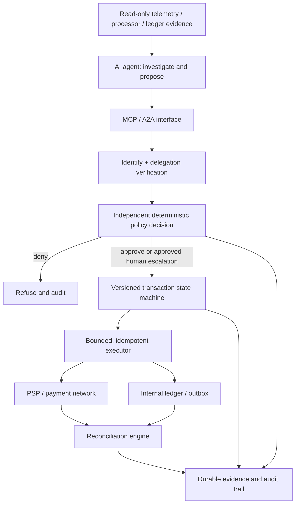

# Deterministic Agentic AI Governance for Mission-Critical Payment Infrastructure

**Architect's research knowledge base — v1.0 | 31 October 2026**

> **Scope and provenance.** This is a newly curated, source-linked reference library aligned with the architecture under discussion. It is **not** a claim that each source was previously used or cited in the original design. Official specifications and regulator/standards publications are distinguished from engineering documentation, academic publications, and the architect's original proposals. Regulatory applicability depends on jurisdiction, payment role, and system scope. Re-check version dates before applying controls.

## Core proposition

An AI agent can investigate and propose, but the authority to create financial side effects belongs to an independent, deterministic, policy-controlled transaction execution plane. All financially relevant outcomes require explicit state, durable evidence, and reconciliation of uncertainty.

**Target conceptual stack:** Observability and evidence → AI investigation/planning → MCP/A2A adapter → identity/delegation verification → policy decision point → deterministic transaction state machine → bounded executor → processor/ledger → reconciliation and evidence ledger → human oversight.

**Non-negotiable invariants:**
1. No financial mutation without authenticated principal, scoped delegation, and an authorized operation.
2. A protocol-level tool permission does **not** imply business-level permission to move money.
3. Retries never create a second economic effect; enforce business operation identity and use downstream idempotency where supported.
4. A timeout yields **UNKNOWN**, not presumed failure; reconcile before deciding whether to retry.
5. A successful API response is not synonymous with settlement or a reconciled ledger.
6. Approval binds to transaction amount/currency/payee/purpose/risk and must expire or be revoked when inputs change.
7. Failed/open security controls lead to refusal or authorized human escalation, not autonomous fallback.
8. Every decision must support independent reconstruction: input hash, policy version, identities, evidence, decision, executor result, and reconciliation result.

## Source classification

- **STD** — standards/specifications and authoritative technical standards. Read the exact normative language and scope.
- **REG** — official regulatory or supervisory publications. Not necessarily binding to every entity.
- **OFF** — official project documentation or engineering guidance; useful but not regulatory authority.
- **RES** — academic paper, book, or empirical research; findings may not generalize.
- **DES** — architectural proposal or original design pattern; **not** an adopted external standard.
- **Status** — `core`, `extended`, or `frontier`; the latter often merits fresh peer review before citation.

## Learning pathway and source registry

Each reference includes the question it answers and the resulting implementation artifact.

### L0 — Payment and reliability foundations

| ID | Source (publisher) | Class | Use / expected artifact |
|---|---|---|---|
| P01 | [Principles for Financial Market Infrastructures — CPMI-IOSCO](https://www.bis.org/committees/cpmi/pfmi/overview) | STD, core | Financial finality, governance, operational risk; build financial-truth invariant catalogue. |
| P02 | [CPMI harmonised ISO 20022 cross-border data requirements, updated 26 Feb 2026](https://www.bis.org/publications/harmonised-iso-20022-data-requirements-enhancing-cross-border-payments-updated-report) | STD/guidance, core | Payment message structure, end-to-end identifiers, exceptions; mapping and lineage schema. |
| P03 | [ISO 20022 official site](https://www.iso20022.org/) | STD, core | Message models and official standard ownership; field mapping catalogue. |
| P04 | [PCI SSC Document Library — PCI DSS v4.0.1 and updates](https://www.pcisecuritystandards.org/document_library/) | STD, core | Cardholder-data environment, system controls, payment page scripts; scope/control matrix. |
| P05 | [PCI SSC FAQs](https://www.pcisecuritystandards.org/faqs/) | OFF, extended | Clarifications, validation questions, and implementation scoping; QSA review register. |
| P06 | [Stripe PaymentIntents API](https://docs.stripe.com/payments/payment-intents) | OFF, core | Realistic payment lifecycle and state transitions; provider adapter test harness. |
| P07 | [Stripe Idempotent Requests](https://docs.stripe.com/api/idempotent_requests) | OFF, core | Idempotency semantics and bounded provider-specific assumptions; retry policy. |
| P08 | [Stripe Webhooks](https://docs.stripe.com/webhooks) | OFF, core | Asynchronous outcome notification, duplicates and out-of-order events; event consumer tests. |
| P09 | [Google SRE books](https://sre.google/books/) | OFF/books, core | SLOs, incident response, error budgets, toil; SLO and incident handbook. |
| P10 | [AWS Builders' Library](https://aws.amazon.com/builders-library/) | OFF, core | Retries, timeouts, backoff, overload, distributed services; fault model. |
| P11 | [OpenTelemetry Documentation](https://opentelemetry.io/docs/) | OFF, core | Distributed tracing, logs, metrics, context correlation; evidence instrumentation plan. |
| P12 | [OpenTelemetry Specification](https://opentelemetry.io/docs/specs/otel/) | STD, core | Trace and context semantics; span and provenance specification. |

### L1 — Distributed systems, transactions, and financial correctness

| ID | Source | Class | Use / expected artifact |
|---|---|---|---|
| D01 | [Designing Data-Intensive Applications — Martin Kleppmann](https://dataintensive.net/) | RES/book, core | Consistency, replication, transactions, delivery guarantees; correctness notes. |
| D02 | [The Tail at Scale — Dean & Barroso, CACM](https://research.google/pubs/the-tail-at-scale/) | RES, core | Tail latency and fanout effects in high-QPS services; p99 budget. |
| D03 | [Paxos Made Simple — Leslie Lamport](https://lamport.azurewebsites.net/pubs/paxos-simple.pdf) | RES, extended | Consensus and agreement; distinguish quorum state from external PSP truth. |
| D04 | [Raft — In Search of an Understandable Consensus Algorithm](https://raft.github.io/) | RES, extended | Replicated logs and leader failure; durable journal design. |
| D05 | [TLA+ and PlusCal resources — Leslie Lamport](https://lamport.azurewebsites.net/tla/tla.html) | RES/tool, advanced | Specify safety and liveness of payment state machine. |
| D06 | [Jepsen analyses](https://jepsen.io/analyses) | RES, advanced | Real-world consistency failures; adversarial test catalogue. |
| D07 | [Temporal Documentation](https://docs.temporal.io/) | OFF, advanced | Durable workflows, replay, activity retries and compensation; workflow execution design. |
| D08 | [Saga pattern — Microsoft Architecture Center](https://learn.microsoft.com/en-us/azure/architecture/patterns/saga) | OFF, core | Distributed compensation and the limits of rollback; compensation contract. |
| D09 | [Transactional Outbox pattern — microservices.io](https://microservices.io/patterns/data/transactional-outbox.html) | Engineering reference, core | Align state mutation and event publication; atomic-outbox prototype. |
| D10 | [TigerBeetle Documentation](https://docs.tigerbeetle.com/) | OFF, extended | Double-entry accounting concepts and transfer invariants; ledger validation fixtures. |
| D11 | [Interledger Protocol documentation](https://interledger.org/developers/) | OFF, extended | Prepare/fulfill/reject style interledger semantics; multi-leg payment model. |
| D12 | [Mojaloop Documentation](https://docs.mojaloop.io/) | OFF, extended | Open payment switch architecture and settlement; integration case study. |

### L2 — Agent systems, MCP, and trusted interoperability

| ID | Source | Class | Use / expected artifact |
|---|---|---|---|
| A01 | [Model Context Protocol Specification, 2025-11-25](https://modelcontextprotocol.io/specification/2025-11-25) | STD, core | Lifecycle, transports, tools, schemas, error handling; MCP protocol boundary. |
| A02 | [MCP Authorization, 2025-11-25](https://modelcontextprotocol.io/specification/2025-11-25/basic/authorization) | STD, core | OAuth, resource metadata, token audience, scoped access; gateway auth matrix. |
| A03 | [MCP Security Best Practices](https://modelcontextprotocol.io/specification/2025-11-25/basic/security_best_practices) | STD/guidance, core | Token passthrough, confused deputy, SSRF and privilege pitfalls; threat assessment. |
| A04 | [MCP Tools](https://modelcontextprotocol.io/specification/2025-11-25/server/tools) | STD, core | Model tool discovery/invocation boundary; allowlisted tool schema registry. |
| A05 | [Agent2Agent protocol — official repository](https://github.com/a2aproject/A2A) | OFF/protocol, extended | Inter-agent delegation and trust; inter-agent auth and provenance contracts. |
| A06 | [Google Agent Development Kit](https://google.github.io/adk-docs/) | OFF, extended | Multi-agent orchestration concepts; non-production benchmark implementation. |
| A07 | [LangGraph documentation](https://docs.langchain.com/oss/python/langgraph/overview) | OFF, extended | Agent graph workflows and checkpointing; baseline comparison. |
| A08 | [ReAct: Synergizing Reasoning and Acting in Language Models](https://arxiv.org/abs/2210.03629) | RES, core | How reasoning/action loops work; untrusted agent proposal model. |
| A09 | [Toolformer: Language Models Can Teach Themselves to Use Tools](https://arxiv.org/abs/2302.04761) | RES, extended | Tool use fundamentals; tool-call failure taxonomy. |
| A10 | [OWASP Top 10 for Agentic Applications, 2026](https://genai.owasp.org/resource/owasp-top-10-for-agentic-applications-for-2026/) | Community security guidance, core | Agent goal hijack, tool abuse, privilege misuse, cascading failure; threat table. |
| A11 | [OWASP LLM Top 10, 2026](https://genai.owasp.org/resource/owasp-genai-llm-top-10-2026/) | Community security guidance, core | Prompt injection, model and supply chain failure; adversarial harness. |
| A12 | [MITRE ATLAS](https://atlas.mitre.org/) | Threat knowledge base, core | Adversarial ML attack techniques; threat-to-control map. |

### L3 — Deterministic policy, identity, and security controls

| ID | Source | Class | Use / expected artifact |
|---|---|---|---|
| G01 | [NIST SP 800-207 Zero Trust Architecture](https://doi.org/10.6028/NIST.SP.800-207) | STD/guidance, core | Never infer trust from network location; service/agent identity trust boundaries. |
| G02 | [NIST SP 800-207A cloud-native access control](https://csrc.nist.gov/pubs/sp/800/207/a/final) | STD/guidance, core | Application and service identity in multi-cloud; service authorization blueprint. |
| G03 | [NIST SP 800-63-4 Digital Identity Guidelines](https://pages.nist.gov/800-63-4/) | STD/guidance, core | Identity proofing, authentication, federation; approval identity assurance. |
| G04 | [NIST SP 800-53 Rev 5 Security and Privacy Controls](https://csrc.nist.gov/pubs/sp/800/53/r5/upd1/final) | STD/guidance, core | Auditable access, change, configuration, and risk controls; control mapping. |
| G05 | [Open Policy Agent documentation](https://www.openpolicyagent.org/docs) | OFF, core | Externalized policy decision point; reference policy service. |
| G06 | [Rego policy language](https://www.openpolicyagent.org/docs/policy-language) | OFF, core | Deterministic rules over explicit inputs; policy test suite. |
| G07 | [Cedar Policy Language](https://www.cedarpolicy.com/) | OFF, extended | Authorization model alternative; comparative evaluation. |
| G08 | [OAuth 2.0 Security Best Current Practice — RFC 9700](https://www.rfc-editor.org/rfc/rfc9700.html) | STD, core | Secure authorization flows; issuer/audience controls. |
| G09 | [OAuth 2.0 Token Exchange — RFC 8693](https://www.rfc-editor.org/rfc/rfc8693.html) | STD, extended | Delegation and credential-exchange semantics; delegation design. |
| G10 | [OAuth 2.0 Resource Indicators — RFC 8707](https://www.rfc-editor.org/rfc/rfc8707.html) | STD, core | Bind a token to resource audience; gateway token verification. |
| G11 | [SPIFFE specifications](https://spiffe.io/docs/latest/spiffe-about/overview/) | OFF/spec, extended | Workload identity, short-lived credentials; executor identity plan. |
| G12 | [SLSA supply-chain framework](https://slsa.dev/) | Community framework, extended | Build provenance and artifact integrity; policy-bundle release attestations. |
| G13 | [Sigstore documentation](https://docs.sigstore.dev/) | OFF, extended | Signing and artifact provenance; signed policy manifest. |

### L4 — Responsible AI, risk, governance, and payment compliance

| ID | Source | Class | Use / expected artifact |
|---|---|---|---|
| R01 | [NIST AI RMF 1.0](https://doi.org/10.6028/NIST.AI.100-1) | STD/voluntary guidance, core | Govern–Map–Measure–Manage lifecycle; governance register. |
| R02 | [NIST Generative AI Profile, AI 600-1](https://doi.org/10.6028/NIST.AI.600-1) | STD/voluntary guidance, core | Generative-specific risks; model and agent risk assessment. |
| R03 | [NIST AI Resource Center and Playbook](https://airc.nist.gov/) | OFF, core | TEVV and documentation practices; evidence checklist. |
| R04 | [NIST AI RMF Critical Infrastructure Profile — status page](https://www.nist.gov/itl/ai-risk-management-framework) | Developing guidance, frontier | Monitor draft/profile rather than represent it as final. |
| R05 | [ISO/IEC 42001 AI management systems](https://www.iso.org/standard/81230.html) | STD, core | Organization-level AI controls and management system; ownership/RACI map. |
| R06 | [ISO/IEC 23894 AI risk management](https://www.iso.org/standard/77304.html) | STD, extended | AI risk analysis and treatment methods; risk register methodology. |
| R07 | [DORA regulation — EUR-Lex](https://eur-lex.europa.eu/eli/reg/2022/2554/oj) | REG, region-specific | ICT operational resilience for applicable EU financial entities. |
| R08 | [EU AI Act — EUR-Lex](https://eur-lex.europa.eu/eli/reg/2024/1689/oj) | REG, region-specific | AI requirements and applicability; use case classification. |
| R09 | [BIS CPMI cross-border payments](https://www.bis.org/committees/cpmi/cross-border-payments.htm) | REG/policy, core | Cross-border interoperability and risk; corridor constraints. |
| R10 | [OWASP Agentic Security Initiative](https://genai.owasp.org/initiatives/agentic-security-initiative/) | Community guidance, core | Agent security governance; adversarial scenarios. |
| R11 | [OWASP State of Agentic AI Security and Governance 2.01 (June 2026)](https://genai.owasp.org/resource/state-of-agentic-ai-security-and-governance/) | Community report, extended | Compare enterprise practices, not normative compliance. |
| R12 | [PCI SSC Software Security Framework](https://www.pcisecuritystandards.org/standards/software-security-framework/) | STD, extended | Payment software lifecycle and secure components; SDLC security mapping. |

### L5 — Experimental validation, benchmark design, and frontier work

| ID | Source | Class | Use / expected artifact |
|---|---|---|---|
| X01 | [TLA+ tools and examples](https://github.com/tlaplus/tlaplus) | OFF/tool, advanced | Model-check forbidden state transitions and duplicate effects. |
| X02 | [Jepsen test analyses](https://jepsen.io/analyses) | RES, advanced | Fault injection methodology for distributed correctness. |
| X03 | [OpenTelemetry semantic conventions](https://opentelemetry.io/docs/specs/semconv/) | STD, core | Consistent trace correlation across agent, tool, policy, PSP, ledger. |
| X04 | [Google SRE Workbook](https://sre.google/workbook/table-of-contents/) | OFF/book, core | Incident drills, alerting and recovery SLOs; experiment metrics. |
| X05 | [Chaos Mesh](https://chaos-mesh.org/docs/) | OFF/tool, advanced | Controlled fault injection in Kubernetes; failure matrix. |
| X06 | [LitmusChaos documentation](https://docs.litmuschaos.io/) | OFF/tool, advanced | Infrastructure chaos tests; reproducible experiments. |
| X07 | [Mnemosyne: Agentic Transaction Processing for Validating and Repairing AI-generated Workflows](https://arxiv.org/abs/2607.00269) | RES/preprint, frontier | Related work on transaction validation/repair; independently verify latest version, claims, authors. |
| X08 | [Agentic Transaction: Towards ACID-Compliant Agent Systems](https://arxiv.org/abs/2608.13900) | RES/preprint, frontier | Related work on ACID interpretations; compare guarantees with externally observable payment effects. |
| X09 | [Google Research publications](https://research.google/pubs/) | RES index, extended | Discover relevant reliability and distributed-systems papers; record exact citations. |
| X10 | [ACM Digital Library](https://dl.acm.org/) | RES index, extended | Peer-reviewed systems and security work; citation discovery. |
| X11 | [IEEE Xplore](https://ieeexplore.ieee.org/) | RES index, extended | Payment, AI, distributed security literature; citation discovery. |
| X12 | [Crossref](https://search.crossref.org/) | Bibliographic metadata, core | Verify title, DOI, authors, publication version. |

### L6 — Architect's own research and implementable proposals

These are project-specific artifacts and concepts; **they are not externally adopted standards** and should be labelled as proposed architecture in publications.

| ID | Project or proposed contribution | Status | Role in the research |
|---|---|---|---|
| O01 | [mcp-gate — GitHub](https://github.com/ananthaprakashb/mcp-gate) | Project | Capability-scoped proxy, short-lived authorization, replay prevention, schema validation; inspect current code before declaring feature coverage. |
| O02 | [semantic-saga-mcp — GitHub](https://github.com/ananthaprakashb/semantic-saga-mcp) | Project | Durable saga/orchestration, approval, recovery, fencing and policy; inspect current code/tests. |
| O03 | Agentic Transaction Boundary Model (ATBM) | DES | Three truths: intended financial action, observed external outcome, internally recorded outcome. |
| O04 | Agentic Transaction Boundary Protocol (ATBP) | DES | Intent → authorization → execution → observation → reconciliation → settlement. |
| O05 | Deterministic Transaction Control Plane | DES | Independent decision gate, invariant enforcement, state transitions, execution constraints. |
| O06 | Policy-Compiled Deterministic Cross-Border Execution / CBEC | DES | Versioned corridor-specific requirements and immutable policy snapshots. |
| O07 | Payment Surface Integrity Attestation / OKF compliance bundles | DES | Compliance-controlled availability of agent-facing payment handlers; experimental design. |
| O08 | Small Language Models for deterministic incident investigation | DES/research | Low-latency, explainable recommendation with restricted evidence access. |
| O09 | Next-Generation SRE: Policy-Governed MCP Architecture for Safe Agentic Operations in High-Throughput Payment Systems | DES/manuscript | Read-only investigation vs gated, bounded recovery; **conceptual proposal unless experiments are documented**. |

## Control-to-source traceability

| Control | Principal sources | Architecture test |
|---|---|---|
| Identify principal and workload | G01–G03, G11, A02 | Unknown identity is denied. |
| Enforce business authorization, not tool permission alone | A01–A04, G05–G10 | Valid MCP call with unauthorized amount/payee is denied. |
| Authorize transaction-specific intent | P01, P06–P08, O03–O05 | Change in payee/amount invalidates approval. |
| Prevent duplicate economic side effects | P07–P08, D01, D08–D09 | Duplicate and concurrent requests produce at most one permitted effect. |
| Handle timeouts as unknown | P06–P08, D01, D07, O03 | Lost ACK triggers evidence lookup/reconciliation, not blind retry. |
| Protect ledger integrity and finality | P01–P03, D10–D12 | Processor outcome and ledger entries must reconcile. |
| Restrict prompt/tool privilege escalation | A10–A12, G01–G10 | Malicious tool output cannot change policy input authority. |
| Human approval and separation of duties | G03–G04, R01–R06 | High-risk operations have independent signed approval evidence. |
| Preserve useful audit evidence without leaking card data | P04, G04, R01–R03, X03 | Provenance is reconstructable with redaction, retention, access controls. |
| Run bounded autonomous recovery | P09, X04–X06, O09 | Only pre-approved, reversible actions are autonomous. |
| Revalidate on policy change | G05–G06, G12–G13 | Stale or revoked policy/credential cannot execute. |
| Evaluate AI separately from control plane | R01–R03, X01–X12 | Measure model accuracy and **invariant violation rate** independently. |

## Reference architecture and trust boundaries



**Illustrative state machine:** `PROPOSED → VALIDATED → AUTHORIZED → COMMITTING → SUCCEEDED | FAILED | UNKNOWN`; `UNKNOWN → RECONCILING → SUCCEEDED | FAILED | MANUAL_REVIEW`. These are proposed engineering states, not prescribed by MCP/PCI. More detailed payment states may include authorized, captured, cleared, settled, refunded, disputed, reversed, and partially compensated.

## Mandatory engineering artifacts

1. **Threat model**: prompt injection, tool-output spoofing, over-delegation, replay, confused deputy, token theft, PSP API anomalies, cross-region misconfiguration.
2. **State machine specification**: transitions, guards, invariants, failure semantics, manual intervention.
3. **Policy contract**: principal, agent/workload, action, payee, amount, currency, jurisdiction, approval signature, expiry, policy version.
4. **Transaction/evidence envelope**: `intent_id`, `operation_id`, `trace_id`, `idempotency_key`, PSP reference, ledger reference, decision proof, evidence hash.
5. **Reconciliation contract**: uncertain outcome lookup, source ranking, compensation preconditions, dispute and settlement states.
6. **Audit controls**: immutable or tamper-evident event chronology, redaction, cryptographic integrity, separation of roles.
7. **Evaluation suite**: normal traffic and adversarial incident corpus; repeatable fault injection and model comparison.
8. **Compliance evidence mapping**: what is required, by whom, in what scope; assessor validation; never imply automatic certification.

## Research experiments and metrics

**Experiment A — Payment timeout ambiguity:** PSP processes authorization but gateway response is lost. Compare naive agent retries with policy-governed recovery. Outcomes: duplicate authorization rate, correct UNKNOWN classifications, reconciliation time, manual escalation.

**Experiment B — Tool-output injection:** forged or adversarial MCP response says a refund is pre-approved. Evaluate independent policy decisions, unauthorized mutation rate, false acceptance rate, escalation quality.

**Experiment C — Concurrent economic operations:** two agents concurrently request the same refund; inject retries, lease expiry, network partitions, and stale policy decisions. Metrics: duplicate economic effects, fencing correctness, liveness, eventual convergence.

**Experiment D — Multi-region configuration drift:** one region uses outdated limits or policy. Evaluate global denial, policy-version mismatch detection, fail-closed behavior and evidence integrity.

**Experiment E — High-QPS reliability and cost:** latency histogram p50/p95/p99/p99.9, admission throughput, policy evaluation overhead, error budget, false-denial rates, audit write durability, compute/token cost.

**Experiment F — Reconciliation truth:** compare agent conclusion, PSP event stream, provider query, ledger, and settlement report. Measure disputed/unknown transitions and false financial-finality assertions.

**Critical measurement distinction:** high model task success is **not** the same as payment safety. Report model quality, policy soundness, transaction integrity, audit completeness, and recovery latency separately.

## 12-week study and build plan

| Weeks | Focus | Read first | Concrete output |
|---|---|---|---|
| 1–2 | Payment lifecycle + reliability | P01, P04, P06–P12 | Payment states, IDs, SLOs, PCI scope. |
| 3–4 | Transaction failure semantics | D01, D05, D08–D10 | Formal safety invariants, outbox/ledger prototype. |
| 5 | MCP and agent trust boundary | A01–A04, A08, A10 | Tool inventory, protocol/auth threat model. |
| 6 | Identity/delegation | G01–G04, G08–G11 | Authorization context schema. |
| 7–8 | Deterministic governance plane | G05–G07, O03–O05 | Policy evaluator + state machine + approval. |
| 9 | SRE and auditability | P09–P12, X03–X04 | End-to-end trace and evidence contract. |
| 10 | Failure/chaos engineering | X01–X06 | Reproducible experiments, fault scripts. |
| 11 | AI governance + compliance | R01–R12 | Compliance crosswalk, model assessment. |
| 12 | Research/publication readiness | X07–X12, O01–O09 | Related work, benchmarks, reproducibility package, limitations. |

## Knowledge-base repository structure

```text
agentic-payment-governance-kb/
  README.md
  references/
    source-registry.md
    citations.bib
    source-verification-log.csv
  fundamentals/
    payment-lifecycle.md
    distributed-systems.md
    high-qps-sre.md
  protocols/
    iso20022.md
    mcp-auth-tools.md
    a2a.md
  governance/
    identity-delegation.md
    policy-contracts.md
    transaction-state-machine.md
    approvals-and-invariants.md
  operations/
    timeout-unknown-reconciliation.md
    traces-and-audit.md
    incident-runbooks.md
  compliance/
    pci-dss-scope.md
    nist-ai-rmf-crosswalk.md
    jurisdiction-applicability.md
  research/
    literature-review.md
    novelty-and-prior-art.md
    hypotheses.md
    experiment-protocols.md
    datasets-and-results/
  examples/
    payment-envelope.schema.json
    policy.rego
    state-machine.tla
    failure-matrix.csv
```

## Quality and citation policy

For every referenced item, retain: title, publisher, author(s), original publication date, latest revision, canonical URL/DOI, accessed date, source class, applicability, license, sections actually consulted, extracted claims, architecture mappings, and verification result. For standards, capture edition and effective dates, including superseded versions. Check that every claim in a manuscript is supported by the cited section—not merely by an adjacent paper on the same topic.

Do not represent an unpublished proposal as an ISO/IETF/PCI/BIS standard. Do not claim production validation, compliance certification, or experimental benchmark results without the actual implementation data. Likewise, this library is a curated research foundation, not proof that every URL was previously consulted while developing the architecture.

## Next scholarly deliverables

1. **Systematic literature review**: research question, search strings, inclusion/exclusion criteria, deduplication, and structured synthesis across ACM/IEEE/arXiv/standards.
2. **Taxonomy paper**: tool authorization vs economic authorization vs financial finality; why existing AI orchestration abstractions fall short.
3. **Formal specification**: explicit safety properties and counterexample traces in TLA+/PlusCal.
4. **Prototype and benchmark**: independent agent/planner, policy engine, capability gateway, executor, journal, PSP stub, reconciliation service.
5. **Reproducibility pack**: code, synthetic traces, anonymized test evidence, experiment scripts, statistical methods, and threat model.

---

**Editorial verification note (31 October 2026):** official source hubs for NIST, PCI SSC, BIS, MCP, OWASP, Google SRE, and OPA were examined as part of preparing this edition. Many additional specific literature/tool links are curated research leads; they have not all been independently opened, version-checked, or confirmed as the latest release in this pass. In particular, frontier preprints must be checked for final peer-reviewed publication and exact bibliographic metadata before submission.