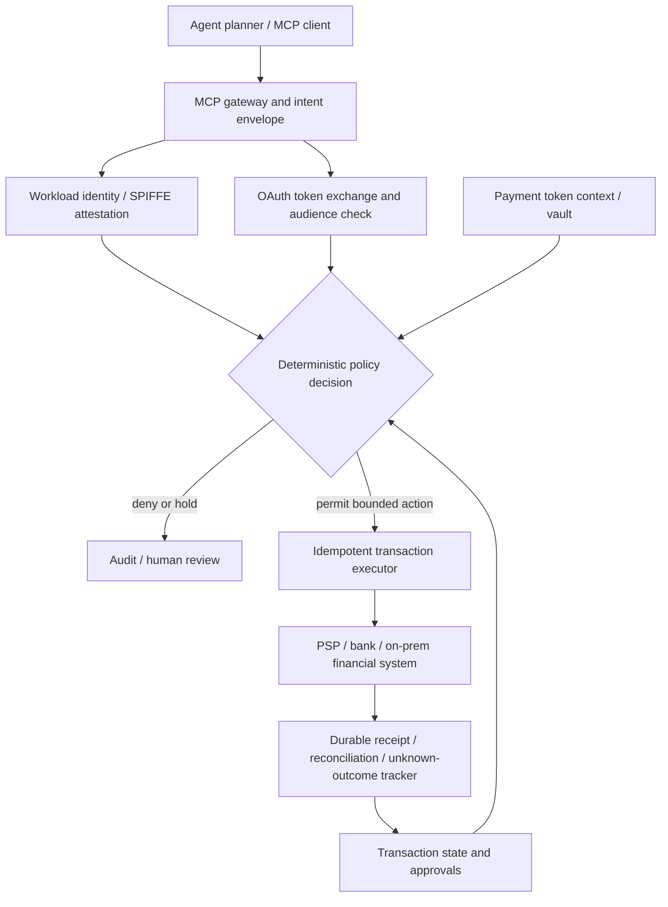

# Research Blueprint — Token-Aware AI Agents

## Problem
Autonomous agents invoke payment, ledger and reconciliation tools across on-prem, AWS, Azure and GCP. A token that authenticates a workload or grants API access does not necessarily grant economic authority to charge a particular instrument or to repeat an uncertain transaction. Cross-cloud token exchange and orchestration introduce confused-deputy, audience-mismatch, replay, context-loss and duplicate-effect risks.

## Proposed research hypothesis
A **token-context-aware policy gateway** (agent-proposed action → identity/authority/context check → deterministic transaction execution → durable reconciliation evidence) can constrain unauthorized financial effects across heterogeneous cloud trust domains while providing acceptable latency at high throughput. This is a hypothesis, **not a demonstrated result**.

## Logical architecture

The LLM never receives raw PAN, private keys, unrestricted bearer tokens, or broad payment-tool credentials. Token broker and vault remain independently controlled. Payment tokens are bound to domains and PSP/network use rules. The gateway checks intent, instrument eligibility, actor, merchant, amount/currency, beneficiary, transaction state, audience, lifetime, binding and replay.

## Research questions
1. Does contextual authorization prevent financial effects when delegated credentials are replayed, swapped across resources or used outside their intended economic constraints?
2. Can actor/subject provenance survive multi-hop token exchange across three cloud identities without broadening privileges?
3. What are the p50/p95/p99 authorization latency and throughput impacts versus direct tool calls and ordinary OAuth-only control?
4. How well does the gateway handle partial outages, delayed processor responses and ambiguous transaction outcomes without blind retries?
5. What can safely be autonomous, and which operations must require explicit approval?

## Threat model
Adversaries: malicious prompts/documents, compromised tools, exfiltrated bearer tokens, rogue workload, misconfigured federation, compromised third-party PSP, insider misuse and message replay.

Trust boundaries: untrusted LLM output; MCP client/server; token-exchange STS; workload identity provider; payment token vault; cloud-to-cloud federation; transaction executor; settlement/ledger provider; reconciliation datastore.

Properties: *least authority*, cross-audience rejection, cryptographic sender binding where supported, no token passthrough, expiry/revocation handling, amount/merchant restrictions, auditability and explicit uncertainty state. Credential authentication is not an authorization decision.

## Experiments
| Test | Condition | Expected invariant |
|---|---|---|
| E01 | Valid single-cloud payment initiation | Authorized, recorded, exactly one permitted business effect |
| E02 | Wrong merchant or exceeding approved amount | Denied before PSP |
| E03 | Agent prompt injection altering beneficiary | Denied; original approval preserved |
| E04 | Cross-cloud stolen bearer token | Rejected when sender-bound / audience mismatch |
| E05 | Actor-to-actor token exchange | No privilege amplification; actor trace preserved |
| E06 | Expired/revoked short-lived capability | Reject or re-authorize; no silent fail-open |
| E07 | PSP timeout after effect | Mark unknown, reconcile before retry |
| E08 | Replay with same and different idempotency keys | Prevent unauthorized duplicate business effect |
| E09 | Token broker unreachable during payment surge | Safe abstention with bounded queue |
| E10 | Tokenized credential unavailable in other cloud | No insecure detokenization fallback |
| E11 | Federation key rotation and clock skew | Safely recover without authorization bypass |
| E12 | 10k–100k QPS *simulated* authorization bursts | Tail latency, policy cost, saturation and safety |

## Evaluation
- Security: unauthorized effects (target zero in tested scenarios), replay success, privilege escalation, leaked credentials, bypass success, policy evaluation correctness.
- Financial: duplicate charge attempts/effects, unsettled unknowns, reconciliation lag, approval-context mismatch, recoverable versus irreversible mistakes.
- Performance: requests per second, p50/p95/p99 added latency, STS latency, token-exchange cache hit rate, key rotation disruption, resource cost.
- Resilience: fail-closed behavior, recovery time, blast radius and audit completeness.
- Compare: (B0) direct agent-to-PSP; (B1) API gateway + OAuth scopes; (B2) workload identity and resource-bound OAuth; (B3) proposed economic context + deterministic policy and transaction boundary. Unsafe baselines are simulation-only.

## Publication evidence plan
Record exact standards versions and claim support; create public synthetic fixtures with no cardholder data; use reproducible containers and seeded failures; demonstrate policy counterexamples; report confidence intervals and negative results; conduct formal prior-art/related-work review before novelty claims.

## Suggested paper outline
Introduction; distinction among token types; related work; threat model and formal invariants; architecture and trust boundaries; cross-cloud authorization; payment state management; implementation; experimental results; limitations, compliance scoping and future work.
