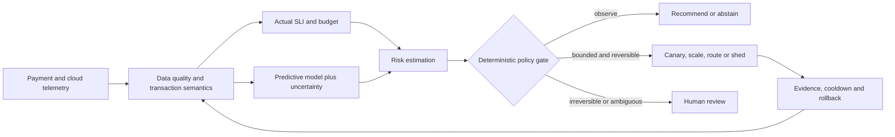

# Research Blueprint — Predictive Error Budget Intelligence for Financial Platforms

## Thesis (hypothesis)

An uncertainty-calibrated SLO-budget predictor plus deterministic action policy can reduce customer-impacting breaches relative to multi-window burn-rate alerts, without increasing unsafe interventions or financial integrity failures. Results are **not yet established**.

## Definitions

For a specified time window W: business SLI = qualified good user-intended payments / eligible user-intended payments. Error budget = (1 − target SLO) × eligible payments. Carefully define payment outcome maturity, timeout-unknown handling and valid exclusions; never silently equate request retry count to distinct business intent count.

Forecast distributions for future eligible events and failed/late events over horizon H. Estimate budget-exhaustion probability and credible uncertainty bounds; treat low denominators, data gaps and regime shifts explicitly. Keep regulatory SLO reporting separate from experimental risk-weighted scores.

## Architecture

No autonomous money movement, ledger edits, irreversible settlement or blind transaction retry. Actions require approved scope, preconditions, rate limits, safety metrics, immutable records, timeout and rollback.

## Research questions and tests

- RQ1: Does predictive risk offer *usable* warning lead time at matched false-alarm rate?
- RQ2: Does bounded automation lower SLO violation frequency, duration or impact?
- RQ3: Is correctness preserved in delayed/ambiguous financial outcomes?
- RQ4: How does model quality vary across sales bursts, processor outages, drift and missing telemetry?
- RQ5: Does reduced alert toil justify computational and operational costs?

**Baselines:** static thresholds; Google multiwindow/multi-burn alerts; seasonal naïve forecast; statistical forecast with manual intervention; full predictive controller with deterministic gate. Include ablations without prediction and without safe actuation (simulation only).

| Test | Injection | Outcome |
|---|---|---|
| E1 | Gradual processor latency growth | Detection lead time and SLI breaches |
| E2 | Abrupt processor timeout | False actions and timeout-unknown correctness |
| E3 | High-QPS flash-sale demand | Budget forecast calibration |
| E4 | Settlement/queue lag | Business SLI vs HTTP SLI |
| E5 | Regional partial network partition | Bounded failover and rollback |
| E6 | Missing telemetry and forecast drift | Abstention and safety |
| E7 | Autoscale oscillation | Cooldown and max actions |
| E8 | Faulty new release | Canary detection and bounded rollback |

**Evaluation:** event-based precision/recall and PR-AUC, Brier score and interval coverage, warning lead time, false alert count per service-week, actual error budget spent, SLO breach duration, p99 business latency, MTTR, rollback success, oscillation, toil hours, cost and **hard-zero unsafe payment mutations**. Backtest with chronological splits and unseen faults, report confidence intervals and counterfactual limitations.

## Proposed twelve-week path

Weeks 1–2: SLIs, domain semantics, risk review and instrumentation. Weeks 3–4: burn-rate baselines. Weeks 5–6: probabilistic forecasting. Weeks 7–8: shadow-mode policy/controller. Weeks 9–10: fault injection and ablation. Weeks 11–12: results and paper.

## Scientific integrity

No invented experimental results. Label synthetic data. Explicitly separate source-backed background, proposed method and demonstrated measurements. Conduct targeted novelty search before asserting originality. See [knowledge base](../knowledge-base/autonomous_reliability_resources.md).
